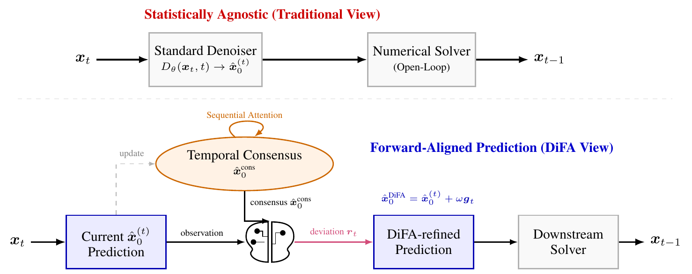
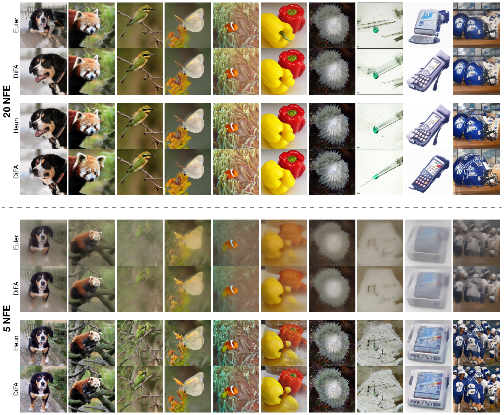

# DiFA: Inference-Time Forward-Process Alignment for Diffusion Models

**SiT implementation for ImageNet 256 × 256.**

<a href="https://proceedings.mlr.press/v306/li26iv.html"></a>
<a href="https://arxiv.org/abs/2607.17972"></a>
<a href="https://pytorch.org/"></a>
<a href="LICENSE"></a>

**Shigui Li<sup>1</sup>, Delu Zeng<sup>2</sup>**

<sup>1</sup>School of Mathematics, South China University of Technology  
<sup>2</sup>School of Electronic and Information Engineering, South China University of Technology

[Paper](https://proceedings.mlr.press/v306/li26iv.html) ·
[arXiv](https://arxiv.org/abs/2607.17972) ·
[PDF](https://arxiv.org/pdf/2607.17972) ·
[Pretrained Assets](https://drive.google.com/drive/folders/1bELRAEK0-9P2LbdQ_TXXerm4e0TsKPIg?usp=sharing)

## Overview

This repository provides the **SiT implementation of DiFA**, with pretrained
SiT-XL/2 sampling and ImageNet 256 × 256 evaluation.

DiFA is a **training-free framework for inference-time data prediction
refinement**. During sampling, a diffusion model produces a sequence of
estimates of the underlying clean signal. These estimates contain temporal
redundancy, but their statistics and reliability change with the noise level.
DiFA uses this sequence to construct a forward-aligned temporal reference
and refine the prediction supplied to the numerical solver.

Inspired by sequential state estimation, DiFA combines two operations:

- **Forward-aligned temporal consensus.** Align historical data predictions
  with the current prediction and aggregate them using structural consistency
  and noise-level compatibility.
- **Deviation guidance.** Use the difference between the current prediction
  and the consensus to preserve residual details and counteract the smoothing
  introduced by temporal aggregation.

The framework can be written as

$$
\widehat{x}_{0,i}^{\mathrm{DiFA}}
=\widehat{x}_{0,i}+\omega\,\mathcal{G}
\bigl(\widehat{x}_{0,i}-\widehat{x}_{0,i}^{\mathrm{cons}}\bigr).
$$

DiFA is inserted between the pretrained model prediction and the solver
update. It reuses existing predictions and introduces **zero additional
network evaluations**. Pretrained weights and the downstream integration
rule are preserved.



*Framework overview reproduced from Figure 1 of the
[DiFA paper](https://arxiv.org/pdf/2607.17972).*

The released implementation uses componentwise temporal memory for
consensus and conditional-response statistic guidance from existing CFG
views. See [Method](docs/method.md) for its complete equations.

## How to Use DiFA

### Data prediction as a common interface

DiFA operates on a model's estimate of the clean signal. Noise, score, and
velocity predictions can be converted into this common representation using
the model's forward-process coefficients. The same interface applies to
spatial predictions in pixel or latent space.

To integrate DiFA into a sampler:

1. Convert the model output to a data prediction.
2. Refine that prediction using the raw history and forward-aligned consensus.
3. Convert the refined prediction back to the representation consumed by the solver.
4. Commit raw observations according to the solver's evaluation lifecycle.

The public core accepts `[batch, channels, height, width]` data-prediction
tensors in pixel or latent space. A model adapter supplies the prediction
conversion, noise-level coordinate, update gain, and history commits. The
ready-to-run pretrained integration in this release is **SiT-XL/2 with Euler
and Heun**. Other spatial-image backbones and solvers can reuse the core
through corresponding adapters.

The complete conditional-response refinement uses raw CFG branch predictions
already computed by the model. Without these views, DiFA uses its temporal
consensus fallback. Conversion equations and adapter requirements are
documented in [Compatibility](docs/compatibility.md), with working tensor and
SiT examples in [Python API](docs/api.md).

### Existing SiT samplers

Wrap an eval-mode SiT model and pass the wrapper as the prediction callable
to the existing sampler:

```python
from difa.adapters import SiTDiFA

prediction = SiTDiFA(model.eval(), guide_scale=1.75, solver="heun")
```

Use one wrapper per independent sample batch, or call `prediction.reset()`.
The adapter handles SiT prediction conversion, CFG views, and history commits.

### Command-line sampling

After preparing the environment and pretrained assets below, choose the
prediction mode and solver independently.

**Original model, without DiFA refinement:**

```bash
python sample.py --no-difa --solver heun --num-steps 20 \
  --output-dir ./outputs/baseline_heun
```

**Model with DiFA refinement:**

```bash
python sample.py --difa --solver heun --num-steps 20 \
  --output-dir ./outputs/difa_heun
```

`--no-difa` passes the model's original CFG prediction directly to the solver.
`--difa` refines that prediction before each solver update. Both modes use
the same pretrained weights and CFG setting.

**Select a different solver:**

```bash
python sample.py --no-difa --solver euler --num-steps 20 \
  --output-dir ./outputs/baseline_euler

python sample.py --difa --solver euler --num-steps 20 \
  --output-dir ./outputs/difa_euler
```

The supplied SiT integration supports Euler and Heun in both modes. The
default is DiFA with Heun; Heun requires an even number of steps. The
refinement core is independent of the solver. Integrating another solver
requires its prediction and history lifecycle adapter, as described in
[Compatibility](docs/compatibility.md).

For multi-GPU sampling, pass the same options through `torchrun`:

```bash
torchrun --standalone --nnodes=1 --nproc_per_node=2 sample.py \
  --no-difa --solver heun --num-steps 20 --output-dir ./outputs/baseline_heun

torchrun --standalone --nnodes=1 --nproc_per_node=2 sample.py \
  --difa --solver heun --num-steps 20 --output-dir ./outputs/difa_heun
```

Settings are loaded from `configs/imagenet256.json`. Use `--config` to select
another JSON file; explicit command-line options override it, including
`--solver`, `--difa`, and `--no-difa`. To compare the prediction modes, use
the same solver, steps, seed, batch size, and GPU count, with separate output
directories. Each directory contains `run_config.json` with the selected settings.

| Optional parameter | Type | Default | Description |
| --- | --- | --- | --- |
| `--config` | Path | `configs/imagenet256.json` | Sampling configuration |
| `--difa` / `--no-difa` | Boolean flags | DiFA enabled | Refined / original model predictions |
| `--solver` | String | `heun` | `euler` or `heun`, in either prediction mode |
| `--num-steps` | Integer | `20` | Sampling steps |
| `--cfg-scale` | Float | `1.5` | Classifier-free guidance scale |
| `--guidance-scale` | Float | `1.75` | DiFA refinement strength |
| `--seed` | Integer | `1` | Random seed |
| `--batch-size` | Integer | `32` | Images per GPU per batch |
| `--num-samples` | Integer | `8` | Number of output images |
| `--output-dir` | Path | `./outputs/samples` | Sample directory |
| `--history-size` | Integer | `3` | Raw prediction history window |

Use `python sample.py --help` for all optional settings.

## Environment Setup

Recommended environment: Python 3.12, PyTorch 2.7.0, torchvision 0.22.0, and
CUDA 12.6 with a compatible NVIDIA driver. One GPU is sufficient for sampling;
multi-GPU sampling uses Linux and NCCL. The package requires Python 3.10 or newer.

```bash
git clone https://github.com/ShiguiLi/DiFA.git
cd DiFA
conda create -n difa python=3.12 -y
conda activate difa
python -m pip install torch==2.7.0 torchvision==0.22.0 --index-url https://download.pytorch.org/whl/cu126
python -m pip install -r requirements.txt
python -m pip install -e . --no-deps
```

For CPU sampling, install the corresponding PyTorch CPU build. To enable
the ADM evaluation backend:

```bash
python -m pip install -r requirements-eval.txt
python scripts/setup_evaluation.py
```

## Data and Pre-trained Models

The supplied adapter supports SiT-XL/2 on ImageNet 256 × 256. Pretrained
weights and evaluation assets are stored under `data/`.

| Asset | Source | Local path |
| --- | --- | --- |
| SiT-XL/2 checkpoint | [SiT](https://github.com/willisma/SiT) | `data/pretrained/SiT-XL-2-256x256.pt` |
| EMA VAE | [Hugging Face](https://huggingface.co/stabilityai/sd-vae-ft-ema) | `data/pretrained/sd-vae-ft-ema/` |
| ImageNet reference NPZ | [ADM evaluation instructions](https://github.com/openai/guided-diffusion/tree/main/evaluations) | `data/references/VIRTUAL_imagenet256_labeled.npz` |
| Inception graph | [ADM](https://github.com/openai/guided-diffusion/tree/main/evaluations) / [asset folder](https://drive.google.com/drive/folders/1bELRAEK0-9P2LbdQ_TXXerm4e0TsKPIg?usp=sharing) | `data/evaluation/classify_image_graph_def.pb` |

Download the checkpoint and VAE with:

```bash
python scripts/download_models.py --output-dir ./data/pretrained
```

The VAE directory must contain `config.json` and the model weights.
ImageNet training data is not required for generation.

## Sampling and Evaluation

Generate separate datasets for the original model and DiFA under the same
sampling settings:

```bash
python sample.py --no-difa --solver heun --num-steps 20 \
  --num-samples 50000 --batch-size 32 --seed 1 \
  --output-dir ./outputs/imagenet256_baseline --skip-packing

python sample.py --difa --solver heun --num-steps 20 \
  --num-samples 50000 --batch-size 32 --seed 1 \
  --output-dir ./outputs/imagenet256_difa --skip-packing
```

Use `--solver euler` in either command to select Euler. Evaluate each dataset
of numbered RGB PNGs using the same ADM reference:

```bash
python eval.py --sample-dir ./outputs/imagenet256_baseline --num-samples 50000 \
  --reference-statistics ./data/references/VIRTUAL_imagenet256_labeled.npz \
  --inception-graph ./data/evaluation/classify_image_graph_def.pb \
  --output-file ./outputs/baseline_metrics.json

python eval.py --sample-dir ./outputs/imagenet256_difa --num-samples 50000 \
  --reference-statistics ./data/references/VIRTUAL_imagenet256_labeled.npz \
  --inception-graph ./data/evaluation/classify_image_graph_def.pb \
  --output-file ./outputs/difa_metrics.json
```

The evaluator records FID, sFID, Inception Score, Precision, and Recall.
To pack PNGs without computing metrics:

```bash
python eval.py --sample-dir ./outputs/imagenet256_difa --num-samples 50000 --pack-only
```

CPU packing and evaluation can run concurrently with GPU sampling of the
next dataset. Use `--skip-packing` to separate these stages. Evaluation
instructions are in [Evaluation](docs/evaluation.md).

## Repository Structure

The repository root is `DiFA/`. The `difa/` package contains the refinement
algorithm and temporal memory; `SiT/` contains the pretrained backbone and
transport solvers. `difa/adapters/sit.py` connects the two. Run sampling and
evaluation from the repository root using `sample.py` and `eval.py`.

```text
DiFA/                          # DiFA implementation for SiT
├── difa/                       # Data-prediction refinement and temporal memory
│   ├── core.py                 # Public DiFA API
│   ├── history.py
│   ├── memory.py
│   ├── adapters/sit.py         # SiT prediction conversion and lifecycle
│   ├── sampling.py
│   └── _impl/                  # Consensus and deviation-guidance primitives
├── SiT/                        # Vendored SiT backbone and transport
│   ├── models.py               # SiT model definitions and original CFG
│   └── transport/              # Flow path and numerical solvers
├── configs/                    # SiT-XL/2 ImageNet sampling configurations
├── scripts/                    # Model/backend setup and launch scripts
├── third_party/adm/            # Official evaluator setup instructions
├── assets/                     # Paper figures
├── docs/                       # Method, API, compatibility, and evaluation
├── tests/                      # CPU formula and integration checks
├── sample.py                   # Sampling entry point
├── eval.py                     # Evaluation entry point
├── requirements.txt
├── requirements-eval.txt
├── CITATION.bib
└── LICENSE
```

## Examples from the Paper

<p align="center">
  
</p>

*Qualitative examples reproduced from the paper.*

## Citation and Acknowledgements

Use the citation corresponding to the version referenced in your work.

### ICML 2026

For the published conference paper:

```bibtex
@InProceedings{pmlr-v306-li26iv,
  title         = {{D}i{FA}: Inference-Time Forward-Process Alignment for Diffusion Models},
  author        = {Li, Shigui and Zeng, Delu},
  booktitle     = {Proceedings of the 43rd International Conference on Machine Learning},
  pages         = {72134--72156},
  year          = {2026},
  volume        = {306},
  series        = {Proceedings of Machine Learning Research},
  publisher     = {PMLR},
  url           = {https://proceedings.mlr.press/v306/li26iv.html}
}
```

### arXiv

For the arXiv preprint:

```bibtex
@misc{li2026difa_arxiv,
  title         = {{D}i{FA}: Inference-Time Forward-Process Alignment for Diffusion Models},
  author        = {Li, Shigui and Zeng, Delu},
  year          = {2026},
  eprint        = {2607.17972},
  archivePrefix = {arXiv},
  url           = {https://arxiv.org/abs/2607.17972}
}
```

Both independent entries, including the complete PMLR citation, are available
in [CITATION.bib](CITATION.bib).
Paper metadata and affiliations follow the [official proceedings](https://proceedings.mlr.press/v306/li26iv.html)
and [paper](https://arxiv.org/abs/2607.17972); see [Paper information](docs/paper.md).

We acknowledge [SiT](https://github.com/willisma/SiT), which builds on
[DiT](https://github.com/facebookresearch/DiT), and
[guided-diffusion](https://github.com/openai/guided-diffusion) for the backbone,
transport implementation, and evaluation protocol. Third-party attribution is preserved in
[THIRD_PARTY_NOTICES.md](THIRD_PARTY_NOTICES.md).

DiFA is released under the [MIT License](LICENSE).
